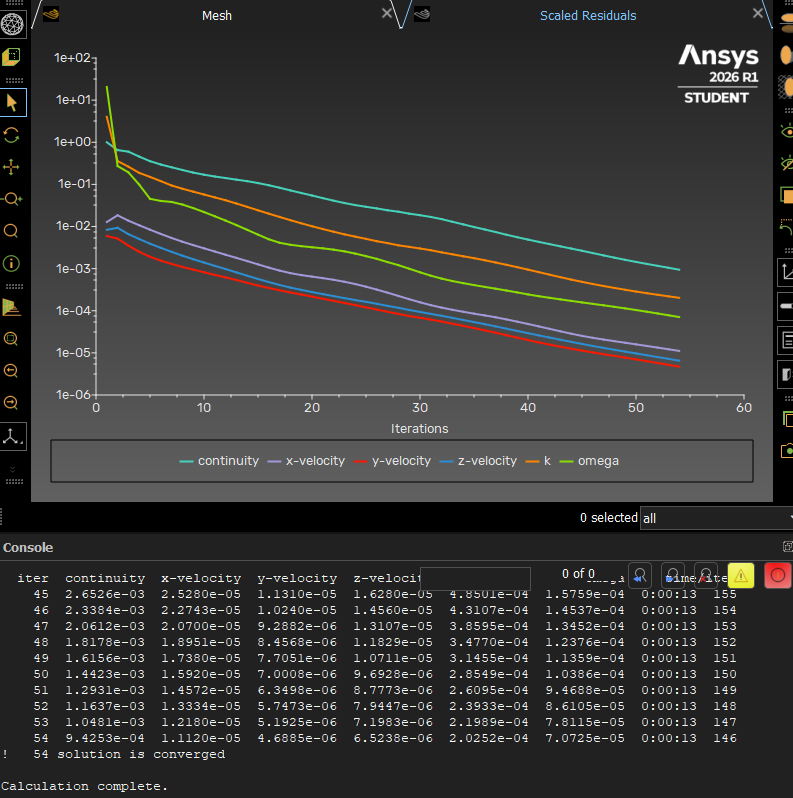
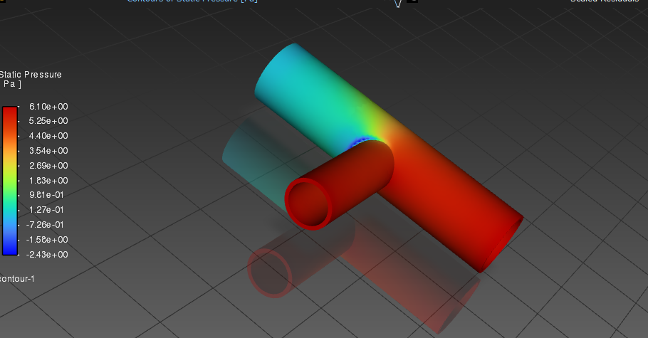
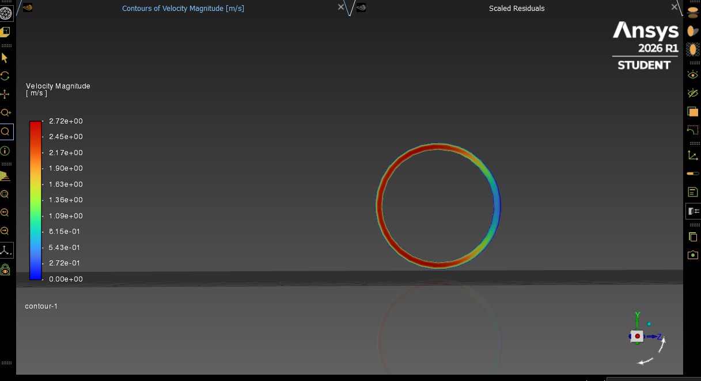

# CFD Simulation: Y-Bifurcation (ANSYS Fluent)

This repository contains a Computational Fluid Dynamics (CFD) simulation of a Y-shaped pipe bifurcation.

## 📋 Project Overview
- **Software:** ANSYS Fluent 2026 R1
- **Turbulence Model:** SST k-omega
- **Fluid:** Water (incompressible)
- **Boundary Conditions:** 2 Inlets (Velocity-Inlet) and 1 Outlet (Pressure-Outlet)
- **Mesh:** Polyhedral/Hexahedral mesh generated in Fluent Meshing

## 📊 Key Results
- **Mass Conservation:** The total mass flow rate at the inlets is 0.01053 kg/s, and at the outlet is 0.01054 kg/s (Numerical error < 0.01%, validating the numerical solution).
- **Pressure Drop:** The average static pressure at the inlets is approximately 6.06 Pa, while the outlet is at 0 Pa (gauge). This 6 Pa drop is due to viscous friction and local turbulence losses at the Y-junction.
- **Velocity Profile:** Flow acceleration was identified at the bend (max velocity ~2.71 m/s) and vortex formation due to the merging of the two streams.

## 📉 Convergence History
The simulation reached convergence after 54 iterations, with scaled residuals dropping below the 1e-03 criteria, ensuring a stable and reliable numerical solution.

## 📸 Visualizations
### Static Pressure Profile

### Velocity Profile

## 📂 Repository Contents
- `pipe-tee-r20mm-solid.cas.h5`: Case file (mesh and setup).
- `pipe-tee-r20mm-solid.dat.h5`: Data file (simulation results).
- `convergence_plot.png`: Convergence history plot.
- `pressureprofile.png`: Static pressure contour plot.
- `velocityprofile.png`: Velocity magnitude and cross-sectional profile plot.

## 👩‍💻 Author
Shalom Scott
[LinkedIn Profile](https://www.linkedin.com/in/shalom-scott-015287212)
